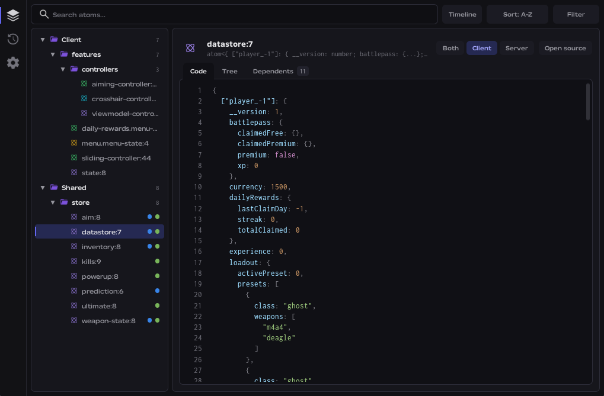

# Charm DevTools

<div align="center">
   
</div>

A Roblox Studio plugin and runtime library for inspecting [Charm](https://github.com/littensy/charm) atoms in real time. You can browse every atom on the server and client, see their current values, step through a timeline of changes with diffs, and see which computeds, effects and listeners depend on each atom.

The repository contains:

| Path | Description |
| --- | --- |
| [`charm-devtools/`](./charm-devtools) | Runtime library you install in your game. It hooks Charm and streams atom updates to the plugin. |
| [`plugin/`](./plugin) | Roblox Studio plugin (UI) built with Vide. |
| [`test/`](./test) | Example place used for local development. |

## Requirements

- A [roblox-ts](https://roblox-ts.com) project
- `@rbxts/charm` `^0.11.0`
- Roblox Studio

## Installation

### 1. Install the Studio plugin

1. Download `plugin.rbxm` from the [latest release](https://github.com/Deepsn/charm-devtools/releases/latest).
2. Move it into your Studio plugins folder:
   - **Windows:** `%LOCALAPPDATA%\Roblox\Plugins`
   - **macOS:** `~/Documents/Roblox/Plugins`
3. Restart Studio. A **Charm DevTools** toolbar with an **Open devtools** button will appear.

### 2. Install the runtime package

The package is not published to npm yet. Install it from the release tarball instead:

```sh
# npm
npm install https://github.com/Deepsn/charm-devtools/releases/latest/download/rbxts-charm-devtools.tgz

# pnpm
pnpm add https://github.com/Deepsn/charm-devtools/releases/latest/download/rbxts-charm-devtools.tgz

# bun
bun add https://github.com/Deepsn/charm-devtools/releases/latest/download/rbxts-charm-devtools.tgz
```

`@rbxts/charm` is a peer dependency, so install it too if you haven't already:

```sh
npm install @rbxts/charm
```

## Setup

Call `install()` on **both the server and the client**, before any code that creates atoms:

```ts
// src/server/main.server.ts
import { install } from "@rbxts/charm-devtools";

install();

// Import modules that create atoms *after* install()
import "./game";
```

```ts
// src/client/main.client.ts
import { install } from "@rbxts/charm-devtools";

install();

import "./app";
```

`install()` patches Charm's `atom`, `computed`, `effect`, `listen`, `subscribe`, `observe` and `untracked`, and tracks every atom created after it runs. Modules that already captured `atom` before `install()` ran (for example, a module required earlier in the entry script) are not tracked. Keep `install()` as the first statement of your entry scripts.

On the server, the library creates a `__CHARM_DEVTOOLS__` folder in `ReplicatedStorage`, with a `RemoteEvent` and a `BindableEvent`. Updates travel to the plugin through it.

> [!NOTE]
> The `install()` function is a no-op when running outside of Studio

### Using it

1. Start a play test in Studio (**Play** or **Run**).
2. Click **Open devtools** in the **Charm DevTools** toolbar.
3. Atoms from the server and client appear in the **State** tab. The **Timeline** tab shows every change, with diffs.

### Labeling atoms

By default, atoms are named after the place in your code where they were created. You can give them readable names:

```ts
import { atom } from "@rbxts/charm";
import { hookAtom, hookAtoms } from "@rbxts/charm-devtools";

const coins = hookAtom(atom(0), { label: "coins" });

// Each key becomes the atom's label
export const store = hookAtoms({
	health: atom(100),
	inventory: atom<string[]>([]),
});
```

`hookAtom` / `hookAtoms` also let you track atoms created *before* `install()` ran, or without calling `install()` at all.

## Development

### Prerequisites

- [Bun](https://bun.sh) `1.3+`
- [Rokit](https://github.com/rojo-rbx/rokit) (installs [Rojo](https://rojo.space) `7.7.1` from [`rokit.toml`](./rokit.toml))
- The [Rojo Studio plugin](https://rojo.space/docs/v7/getting-started/installation/#installing-the-plugin) (optional)

### Getting started

```sh
git clone https://github.com/Deepsn/charm-devtools.git
cd charm-devtools

rokit install
bun install
```

`bun install` runs a `postinstall` script ([`scripts/link-node-modules.ts`](./scripts/link-node-modules.ts)) that links each workspace's `node_modules` to the root `node_modules`.

### Scripts

| Command | Description |
| --- | --- |
| `bun run dev` | Watches every package, rebuilds the plugin into your Studio plugins folder on change, and serves the test place with Rojo (port `32423`). |
| `bun run build` | Builds the library, the plugin and the test place. |
| `bun run build:plugin` | Builds the plugin to `$LOCALAPPDATA/Roblox/Plugins/CharmDevTools.rbxm`. |
| `bun run package` | Builds the library and packs it into `charm-devtools/rbxts-charm-devtools.tgz`. |
| `bun run serve` | Serves the plugin project with Rojo. |
| `bun run serve:test` | Serves the test place with Rojo. |

> [!NOTE]
> The `build:plugin` and `dev` scripts write to `$LOCALAPPDATA/Roblox/Plugins`. On Linux with [Vinegar](https://vinegarhq.org), use [`scripts/dev.sh`](./scripts/dev.sh), which points `LOCALAPPDATA` at the Vinegar prefix.

### Linting and formatting

The project uses [Biome](https://biomejs.dev):

```sh
bunx biome check .
bunx biome check --write .
```